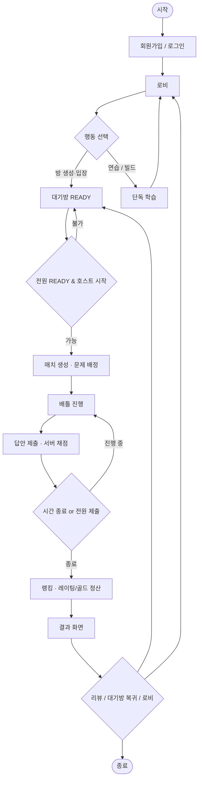

# 1단계: 문제 정의 (Problem Definition)

## 1.1 프로젝트 제안 및 문제 정의서

| 항목 | 내용 |
|------|------|
| 프로젝트명 | **re:zero** (리:제로) |
| 유형 | 실시간 코딩 대결 · 자동 채점 · Electron 클라이언트 |
| 대상 | 컴공 계열 학생, 코딩을 배우는 일반 학습자 |
| 개발 목적 | 혼자 푸는 문제집을 넘어, **실시간 경쟁·피드백**으로 학습 동기와 실력을 동시에 높이는 올인원 플랫폼 |
| 기대 효과 | 대결·아이템·결과 리뷰로 몰입 증가 / 서버 채점으로 공정성 확보 / 연습·빌드로 학습 루프 완성 |

### 문제점 시각화

| 현황 문제 | 사용자 영향 | re:zero에서의 해결 방향 |
|-----------|-------------|-------------------------|
| 코딩 학습이 일방적 문제 풀이에 치우침 | 동기·재미 부족 | 1:1 / 1:N 실시간 배틀 |
| 오프라인·비동기 채점만 존재 | 승패·순위 체감 약함 | 제한시간·등수·레이팅·골드 |
| 대결 중 방해/전략 요소 부재 | 단순 속도 경쟁만 | 아이템전 (페인트·낙서·잠금 등) |
| 결과 후 피드백이 약함 | 오답 복습 어려움 | 결과창 리뷰 초대, AI 분석, 전적 |
| 웹만 쓰면 환경 편차 큼 | 설치·해상도 이슈 | Electron 고정 해상도 + 전체화면 스케일 |

### 해결 목적 (한 줄)

> **공정한 실시간 채점**과 **게임적 대결 UX**를 결합해, 학습자가 재미있게 반복 연습할 수 있는 코딩 배틀 플랫폼을 만든다.

---

## 1.2 Activity Diagram — 핵심 비즈니스 플로우

시스템 전체에서 해결하려는 **핵심 흐름**(로그인 → 매칭/대기 → 배틀 → 결과)입니다.

### 핵심 해결 포인트

| 단계 | 해결하려는 것 |
|------|----------------|
| 대기방 | 공정한 시작 조건(인원·READY·설정) |
| 배틀 | 실시간 동기화 + 서버 판정 |
| 아이템 | 대결 전략성 (일반/아이템 모드) |
| 결과 | 등수·보상·복습으로 학습 루프 닫기 |
