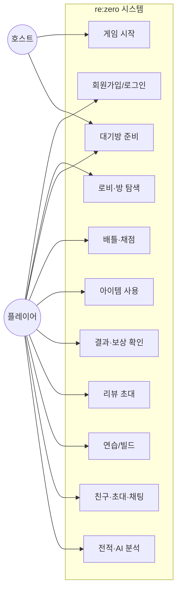

# 2단계: 요구사항 정의 (Requirements Analysis)

## 2.1 MoSCoW 우선순위

### Must Have (필수)

| ID | 요구사항 | 비고 |
|----|----------|------|
| M1 | 회원가입 · 로그인 · 세션 인증 | JWT/세션 |
| M2 | 로비 방 목록 · 생성 · 입장 · 퇴장 | REST + 소켓 |
| M3 | 대기방 READY · 캐릭터 · 호스트 시작 | 1/1, 1/N |
| M4 | 매치 시작 시 문제 자동 선정 | 난이도·언어·개수 |
| M5 | 배틀 중 답안 제출 · 서버 채점 | 빈칸/객관식/단답 |
| M6 | 제한시간 · 게임 종료 · 랭킹 산출 | |
| M7 | 결과 화면 (등수, 인게임 점수, 풀이 시간) | |
| M8 | 레이팅 · 골드 보상 반영 | 등수 연동 |
| M9 | Electron 클라이언트 (창/전체화면) | 1280×960 기준 |

### Should Have (우대)

| ID | 요구사항 | 비고 |
|----|----------|------|
| S1 | 아이템 모드 (공격/자기 강화) | paint, lock, scribble 등 |
| S2 | 채팅 (로비·방·배틀·결과) | Whisper/친구 모드 포함 |
| S3 | 친구 요청 · 방 초대 | 소켓 |
| S4 | 결과 리뷰 초대 | 상대와 문제 복습 |
| S5 | 연습 모드 · 빌드 시스템 | 단독 학습 |
| S6 | 매치 전적 · 코드 히스토리 | |
| S7 | 칭호 · 룰렛(아이템 획득) | |

### Could Have (확장)

| ID | 요구사항 | 비고 |
|----|----------|------|
| C1 | AI 사용자 분석 (정답률·레이더) | Cursor API 연동 |
| C2 | 관전 · 수정(revise) 아이템 | |
| C3 | 비공개 방 비밀번호 | |
| C4 | 재접속 복원 | 배틀 중 |

### Won't Have (이번 범위 밖)

| ID | 내용 |
|----|------|
| W1 | 관리자 CMS 웹 (문제 등록 UI) — DB·시드로 관리 |
| W2 | 모바일 네이티브 앱 |
| W3 | 완전 자동 CI/CD 클라우드 배포 |

---

## 2.2 비기능 요구사항

| 구분 | 요구 | 구현 대응 |
|------|------|-----------|
| 실시간성 | 대기·배틀·채팅 지연 최소화 | Socket.io + Valkey presence |
| 공정성 | 채점·보상은 서버 기준 | Express battle API |
| 보안 | 비밀번호 해시, API 인증 | bcrypt, auth 미들웨어 |
| 격리 | 코드 실행 샌드박스 | Podman 컨테이너 |
| UX 일관성 | 해상도·폰트 편차 완화 | Electron 고정 캔버스 + 전체화면 스케일 |
| 가용성 | DB/캐시 없으면 기동 실패를 명확히 | MariaDB·Valkey 필수 연결 |

---

## 2.3 Use Case Diagram

### Use Case 요약 표

| Use Case | 주체 | 사전조건 | 성공 후 상태 |
|----------|------|----------|--------------|
| 로그인 | 플레이어 | 계정 존재 | 로비 진입 |
| 방 생성/입장 | 플레이어 | 로그인 | 대기방 참가 |
| READY | 플레이어 | 대기방 | READY 동기화 |
| 게임 시작 | 호스트 | 인원·READY·설정 OK | 매치 IN_PROGRESS |
| 답안 제출 | 플레이어 | 매치 진행 중 | 점수·정오 반영 |
| 아이템 사용 | 플레이어 | 아이템 모드·보유 | 효과/힌트 적용 |
| 결과 확인 | 플레이어 | 매치 종료 | 랭킹·골드·레이팅 |
| 리뷰 | 플레이어 | 결과 화면·상대 잔류 | 공동 문제 복습 |
