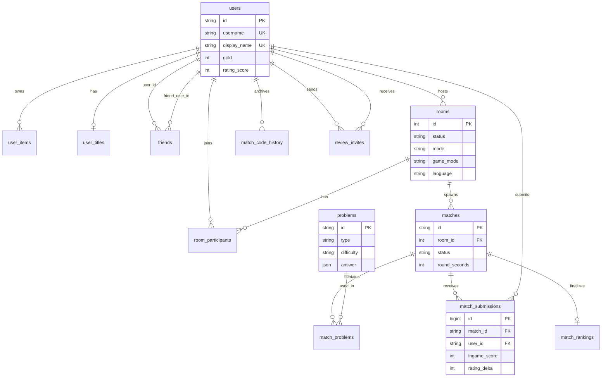
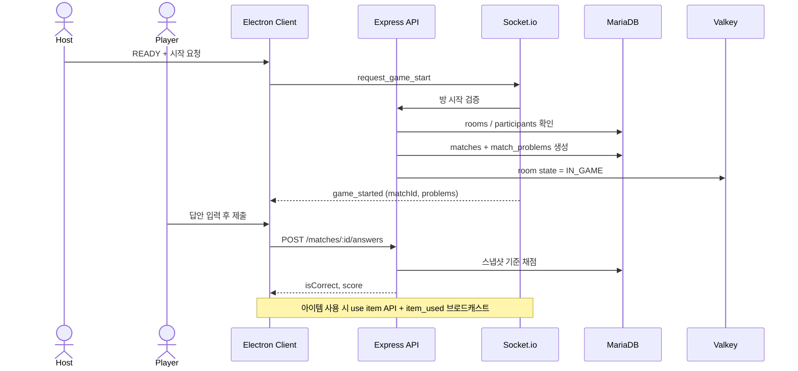
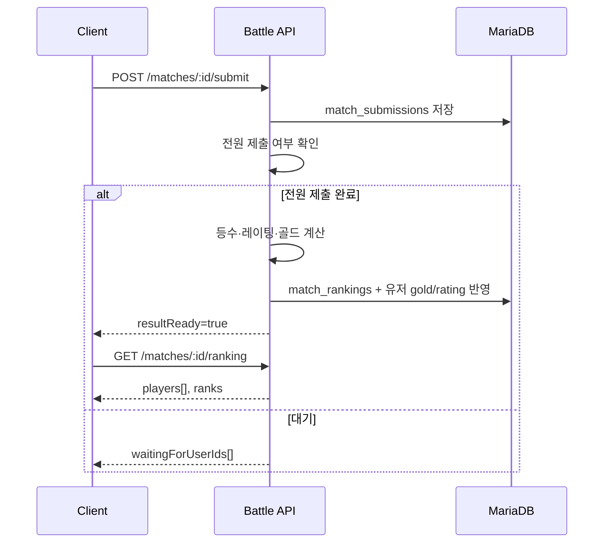

# 3단계: 시스템 설계 (System Design)

## 3.1 ERD (Entity-Relationship Diagram)

MariaDB 스키마(`backend/src/models/osDB.sql`) 기준 핵심 관계입니다.



### 테이블 역할 요약

| 테이블 | 역할 |
|--------|------|
| `users` | 계정·닉네임·골드·레이팅 |
| `user_items` / `user_titles` | 아이템 보유, 칭호·전적 스탯 |
| `rooms` / `room_participants` | 대기방·슬롯·READY |
| `problems` | 문제 은행 |
| `matches` / `match_problems` | 매치 세션·배정 문제 스냅샷 |
| `match_submissions` / `match_rankings` | 제출·점수·최종 순위 |
| `match_code_history` | 결과 후 코드/전적 아카이브 |
| `friends` / `review_invites` | 소셜·리뷰 |

Valkey(Redis)에는 로비 presence, 방 상태(`IN_GAME` 등), 세션성 데이터를 둡니다 (영구 ERD 밖).

---

## 3.2 API 명세서 (요약)

Base: `/api/v1` · 인증: 로그인 세션/토큰 (표기: Auth)

### 인증 · 사용자

| Method | Endpoint | Auth | 설명 |
|--------|----------|------|------|
| POST | `/auth/signup` | | 회원가입 |
| POST | `/auth/login` | | 로그인 |
| GET | `/users/me` | ✓ | 내 프로필·골드·아이템 |
| DELETE | `/users/me` | ✓ | 회원 탈퇴 |
| POST | `/users/me/title` | ✓ | 칭호 장착 |
| POST | `/users/me/roulette` | ✓ | 룰렛 |
| GET/POST/DELETE | `/users/me/match-history` | ✓ | 전적 |
| POST | `/users/ai-analysis` | ✓ | AI 분석 |
| GET | `/users/online` | ✓ | 온라인 목록 |
| GET | `/users/me/friends` | ✓ | 친구 목록 |

### 방

| Method | Endpoint | Auth | 설명 |
|--------|----------|------|------|
| GET | `/rooms` | ✓ | 방 목록 |
| POST | `/rooms` | ✓ | 방 생성 |
| GET | `/rooms/:id` | ✓ | 방 상세 |
| POST | `/rooms/:id/join` | ✓ | 입장 |
| POST | `/rooms/:id/leave` | ✓ | 퇴장 |
| POST | `/rooms/:id/kick` | ✓ | 강퇴 |
| GET | `/rooms/:id/can-start` | ✓ | 시작 가능 여부 |
| POST | `/rooms/:id/start` | ✓ | 게임 시작 |
| DELETE | `/rooms/:id` | ✓ | 방 삭제 |

### 배틀

| Method | Endpoint | Auth | 설명 |
|--------|----------|------|------|
| POST | `/matches/start` | ✓ | 매치·문제 배정 |
| GET | `/matches/active/:roomId` | ✓ | 진행 중 매치 |
| POST | `/matches/:id/answers` | ✓ | 문제 답안 채점 |
| POST | `/matches/:id/items/use` | ✓ | 아이템 사용 |
| POST | `/matches/:id/items/revise` | ✓ | 수정 아이템 |
| POST | `/matches/:id/submit` | ✓ | 결과 제출 |
| GET | `/matches/:id/pending` | ✓ | 제출 대기 |
| GET | `/matches/:id/ranking` | ✓ | 최종 랭킹 |

### Request / Response 예시 (답안 제출)

**Request** `POST /matches/:matchId/answers`

```json
{
  "problemIndex": 0,
  "answers": ["printf"],
  "selectedOption": null
}
```

**Response (성공)**

```json
{
  "isCorrect": true,
  "score": 100
}
```

**오류 공통**

```json
{
  "error": {
    "code": "ITEM_NOT_AVAILABLE",
    "message": "보유한 아이템이 없습니다."
  }
}
```

### 주요 Socket 이벤트

| 이벤트 | 방향 | 용도 |
|--------|------|------|
| `join_room` | C→S | 방/로비 소켓 입장 |
| `toggle_ready` / `ready_changed` | 양방향 | READY |
| `request_game_start` / `game_started` | 양방향 | 시작 |
| `item_used` | S→C | 아이템 효과 브로드캐스트 |
| `lobby_presence` | S→C | 위치(lobby/room/battle/result) |
| `review_invite` | 양방향 | 결과 리뷰 |
| `send_message` / `receive_message` | 양방향 | 채팅 |

---

## 3.3 Sequence Diagram — 게임 시작 ~ 첫 채점



## 3.4 Sequence Diagram — 결과 정산


