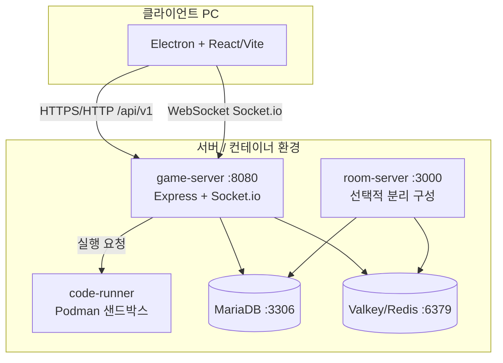

# 4단계: 구조 생성 및 인프라 (Architecture & Infrastructure)

## 4.1 인프라 구성도 / Deployment Diagram

`backend/docker-compose.yml` 기준 서비스:

| 서비스 | 역할 | 포트 |
|--------|------|------|
| `game-server` | 메인 API·소켓 | 8080 |
| `room-server` | 방 관련 분리 배포 옵션 | 3000 |
| `code-runner` | 코드 실행 샌드박스 | — |
| `db` | MariaDB 10.11 | 3306 |
| `valkey` | Redis Alpine | 6379 |

공유 볼륨: sandbox / resultbox / db 데이터 (`shared/fileShare/...`).

---

## 4.2 기술 스택 & 선정 이유

| 계층 | 기술 | 선정 이유 |
|------|------|-----------|
| 클라이언트 | React + TypeScript + Vite | 컴포넌트 UI, 타입 안정, 빠른 HMR |
| 데스크톱 | Electron | 해상도·환경 고정, 게임형 UX |
| 서버 | Express (Node 20) | 프론트와 JS 스택 통일, 실시간과 REST 동시 |
| 실시간 | Socket.io | 방·채팅·아이템·presence |
| DB | MariaDB | 관계형 매치·유저·문제 영속화 |
| 캐시 | Valkey(Redis) | presence·방 상태·휘발성 세션 |
| 실행 | Podman | 코드 실행 격리 |
| 에디터 | CodeMirror | 연습·빌드 코드 편집 |

---

## 4.3 Git 전략

| 브랜치 | 용도 |
|--------|------|
| `main` | 안정본 · 발표/배포 기준 |
| `develop` | 통합 개발 (일상 작업) |
| `feature/*` | 기능 단위 작업 후 develop 머지 |

커밋 메시지: 한국어 `fix:` / `docs:` 등 목적 중심.  
의존성: **저장소 루트** `package.json` + `npm ci` (프론트/백 분리 설치 금지).

---

## 4.4 모듈화

| 영역 | 위치 | 책임 |
|------|------|------|
| 페이지 UI | `frontend/src/pages/*` | 화면 단위 |
| 서비스 | `frontend/src/services/*` | REST·소켓·로컬 세션 |
| API 도메인 | `backend/src/api/{user,room,battle,problem,build}` | 기능별 라우터·서비스 |
| 소켓 | `backend/src/handler` | 이벤트 핸들러 |
| 인프라 | `backend/src/infra/{redis,docker}` | Valkey·Podman |

---

## 4.5 CI/CD

| 항목 | 현황 |
|------|------|
| 자동 빌드/배포 파이프라인 | **미구축** (Won't 범위) |
| 배포 방식 | 서버 `git pull` + `npm ci` + 백엔드 재시작 / compose up |
| 검증 | 로컬·서버 수동 스모크 (로그인→방→배틀→결과) |

향후 과제: GitHub Actions로 lint/build 자동화 가능.
