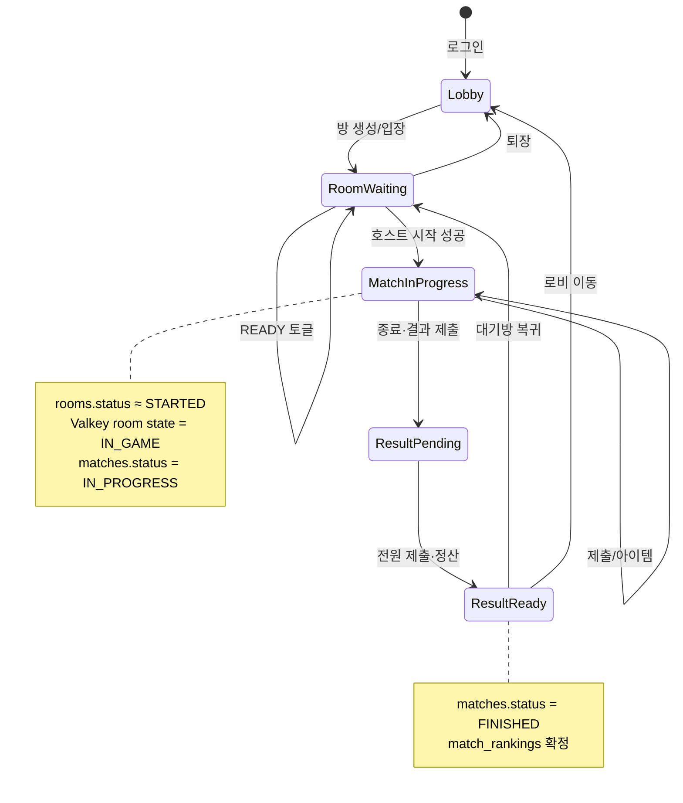

# 5단계: 구현 (Implementation)

## 5.1 주요 화면 구성

| 화면 | 경로(개념) | 구현 포인트 |
|------|------------|-------------|
| 로그인 | LoginPage | 회원가입/로그인, 세션 hydrate |
| 로비 | LobbyPage | 방 목록, 채팅, 인벤토리, 룰렛, 설정 |
| 대기방 | RoomPage | 1/1·1/N 슬롯, READY, 아이템 로드아웃 |
| 배틀 | BattlePage | 문제 패널, 타이머, 상대 패널, 아이템 |
| 결과 | ResultPage | 랭킹, 골드/레이팅, 리뷰 초대, 전적 저장 |
| 연습 | PracticePage | 단독 풀이 |
| 빌드 | BuildPage | 블록 조립·미리보기 |

---

## 5.2 핵심 로직 스니펫 (개념)

### 서버 채점 흐름 (배틀)

클라이언트는 정답을 들고 있지 않고, `POST /matches/:id/answers`로 제출 → 서버가 `match_problems.problem_snapshot` 기준으로 판정 → `score` 반환.

### 랭킹·보상

| 규칙 | 내용 |
|------|------|
| 정렬 | 인게임 점수 ↓ → completionTime ↑ → totalSolveTime ↑ |
| 승자 | 등수 `1 ~ ceil(인원/2)` |
| 레이팅 | 기본 `max(10, floor(점수/10))` + 등수 보너스/페널티 |
| 골드 | `인게임점수 + (인원-등수)×10` (무승부 0점 시 0) |

### 아이템 효과

| 구분 | 키 | 동작 |
|------|-----|------|
| 공격 | paint, lightning, scribble, lock, timeReduce | 상대 화면/시간 방해 (같은 타입은 큐 누적) |
| 자기 | revealLength, revealPrev, blankBreak, buildCharge | 힌트·빈칸·빌드 횟수 |
| 특수 | revise | 종료 전 문제 재도전 |

라이브 매치 힌트는 서버 `useBattleItem` effect로 전달 (클라이언트에 정답 미노출).

### UI 스케일

창 모드: 1280×960 고정.  
전체화면: `#root`를 디자인 해상도로 두고 `transform: scale(min(vw/1280, vh/960))`.

---

## 5.3 State Diagram — 방·매치 상태

### 플레이어 presence 위치

| location | 의미 |
|----------|------|
| `lobby` | 로비 |
| `room` | 대기방 |
| `battle` | 배틀 중 |
| `result` | 결과 화면 |
| `practice` / `build` | 단독 모드 |

결과 화면에서 상대가 `lobby`/`room`/오프라인이면 흑백·리뷰 초대 차단.

---

## 5.4 코드 표준

| 항목 | 내용 |
|------|------|
| FE | TypeScript, 페이지/컴포넌트/서비스 분리 |
| BE | 도메인별 `api/*/router·controller·service` |
| 오류 | `{ error: { code, message } }` 통일 |
| 환경 | `backend/.env` (예시: `.env.example`) |
